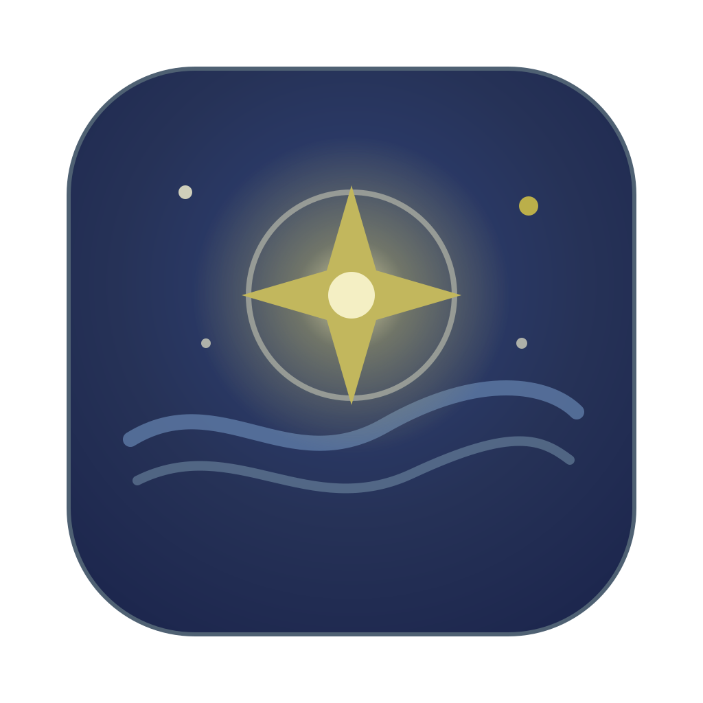

<p align="center">
  
</p>

<h1 align="center">Vard AI</h1>

<p align="center">
  <a href="https://github.com/vardhan23v/Vard-AI/actions/workflows/desktop.yml"></a>
  
  
  <a href="LICENSE"></a>
</p>

<p align="center">
  
  
  
  
  
  
  
</p>

<p align="center">
  
  
  
  
  
</p>

A macOS desktop app that combines a ChatGPT-style **chat** with a Verdent-style **coding agent**. You point the agent at a git project. It plans the work, edits files and runs commands in an isolated worktree, asks before anything risky, and shows you the diff to merge.

Built with Tauri v2, React 19, TanStack Router, Tailwind v4 and shadcn/ui. You bring your own API keys for Anthropic, OpenAI, Gemini, OpenRouter or local Ollama.

## Features

**Chat**
- Conversations grouped by date, with search, pin, rename and delete
- Streaming replies with Markdown, tables and highlighted code blocks (copy button)
- Regenerate, edit-and-resend, and stop (Esc)
- Model picker across every provider you have a key for
- Chats sync across your Macs through Firebase

**Coding agent (Projects)**
- Add any git folder, then describe a task
- **Plan first:** review, edit or reject the agent's plan before it touches code
- Every task runs in its own git worktree (`vard/<task-id>` branch), so tasks run in parallel and never touch your working copy
- Live step log of each file read, edit and command, plus a checklist
- **Approvals:** risky commands wait for *Allow once*, *Always allow in this project* or *Deny*
- Optional verify command (for example `bun test`) that runs after edits; failures go back to the agent
- Review the diff, then **Merge**, **Discard** or **Show in Finder**

**App**
- Sign in with Google or email
- API keys stored in the macOS Keychain
- "Starry Night" theme in dark and light, with three accent colours and a reduced-motion setting

## Install

1. Download `Vard AI_<version>_universal.dmg` (Apple Silicon and Intel).
2. Open it and drag **Vard AI** to Applications.
3. The app isn't notarized yet. On first launch, right-click it in Applications and choose **Open**, then **Open** again.

## Getting started

1. Sign in with Google or email.
2. Open **Settings → API keys** and add a key for at least one provider. OpenRouter's `:free` models work without paying. If they refuse requests, allow them under openrouter.ai → Settings → Privacy.
3. **Chats:** start typing.
4. **Projects:** click **Add project folder**, pick a git repository, describe a task and press ⌘↵.

| Shortcut | Action |
|---|---|
| ⌘N | New chat |
| ⌘\ | Show or hide the sidebar |
| ⌘↵ | Start an agent task |
| Enter / Shift+Enter | Send / new line |
| Esc | Stop a streaming reply |

## Architecture

```
Tauri shell (Rust, src-tauri/)
 ├─ window, folder picker, macOS Keychain for API keys
 ├─ spawns + supervises the `vard-agent` sidecar
 └─ WebView: React SPA (src/)  ⇄  sidecar via JSON-lines over stdio
Sidecar `vard-agent` (TypeScript, harness/, compiled with `bun build --compile`)
 ├─ providers: Vercel AI SDK (Anthropic, OpenAI, Google, OpenAI-compatible, Ollama)
 ├─ chat runner (streaming) + agent harness (loop, tools, policy, worktrees, traces)
 └─ local tools: files, search, edit, shell commands, git
Firebase: sign-in (email + Google) and Firestore sync of chats, projects and task summaries
```

- **Keys never reach the WebView.** The Rust shell reads them from the Keychain and adds them to each sidecar request (`src-tauri/src/lib.rs`).
- **The agent harness is code, not a prompt.**
  - `harness/src/loop.ts`: plan → approve → act → observe → verify state machine
  - `harness/src/policy.ts`: allow / ask / deny rules, path sandbox, command allowlist
  - `harness/src/worktree.ts`: one git worktree per task
  - `harness/src/trace.ts`: a JSONL trace per task in `~/.vard/traces`
  - `harness/src/protocol.ts`: the typed protocol shared with the UI
- **The protocol is shared.** `src/lib/agent-client.ts` imports its types from `harness/src/protocol.ts`.

## Develop

Requirements: macOS 12+, [Bun](https://bun.sh) 1.4+, Rust (stable), and Xcode Command Line Tools.

```bash
bun install
(cd harness && bun install)
cp .env.example .env   # fill in the Firebase web config and Google desktop client
bun run desktop:dev    # builds the sidecar, then starts Tauri with hot reload
```

If you installed Rust with Homebrew's `rustup`, put it on your PATH:

```bash
export PATH="$(brew --prefix rustup)/bin:$PATH"
```

| Command | What it does |
|---|---|
| `bun run dev` | Web UI only, at http://localhost:1420 (no agent; replies need the desktop app) |
| `bun run desktop:dev` | Full desktop app in development |
| `bun run build:agent` | Compile `harness/` to `src-tauri/binaries/vard-agent-<triple>` |
| `bun run desktop:build` | Universal (Apple Silicon + Intel) `.dmg` |
| `bun run typecheck` | Typecheck the app |
| `cd harness && bun test` | Harness unit and loop tests |

The DMG ends up in `src-tauri/target/universal-apple-darwin/release/bundle/dmg/`.

## Firebase

- **Project:** `vard-ai-7f1054` (see `.firebaserc`).
- **Data:** every document lives under `users/{uid}/…`:
  - `conversations/{id}/messages/{id}`
  - `projects/{id}/tasks/{id}`
- **Rules:** [`firestore.rules`](firestore.rules) limits each user to their own data. Deploy them with:

```bash
bunx firebase-tools deploy --only firestore
```

- **Sign-in:** email/password and Google, both enabled under Authentication → Sign-in method.
- **Google in the desktop app:** uses a Google OAuth client of type **Desktop app** in the same Google Cloud project, set through `VITE_GOOGLE_DESKTOP_CLIENT_ID` and `VITE_GOOGLE_DESKTOP_CLIENT_SECRET`. The Rust shell runs the browser sign-in with PKCE and a loopback redirect to `127.0.0.1:47823`, then signs in to Firebase with Google's ID token.
- **Not synced:** project folder paths stay on each Mac.

## Troubleshooting

| Problem | Fix |
|---|---|
| "No … API key saved" | Add the key in **Settings → API keys**. Keys saved by other tools aren't readable by the app. |
| macOS asks for Keychain access | Enter your password and choose **Always Allow**. Unsigned development builds can ask again after a rebuild. |
| OpenRouter 404 or "guardrail restrictions" | Your OpenRouter privacy settings block that model. Allow it, or choose another model. |
| OpenRouter 429 (rate-limited) | Free models are shared. The agent waits and retries; a paid model or your own provider key avoids it. |
| "Sign-in isn't set up" | Enable Authentication and its Email and Google providers in the Firebase console. |
| Google says "access blocked" | Add your account as a test user on the OAuth consent screen, or publish the app. |

## Distribution

Builds are **unsigned** (ad-hoc signature) for now. On first launch, right-click the app and choose **Open**. Signing and notarization need an Apple Developer ID; add them in `src-tauri/tauri.conf.json` (`bundle.macOS.signingIdentity`) and the CI workflow.

CI (`.github/workflows/desktop.yml`) typechecks, runs the harness tests and uploads a universal DMG as a build artifact. It needs the six variables in `.env.example` as repository secrets.

## License

MIT
